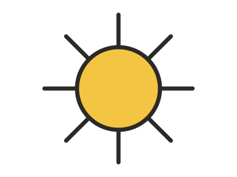
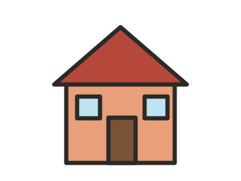
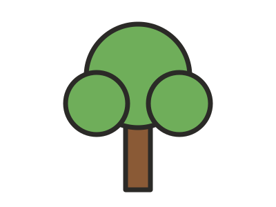
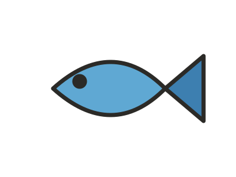
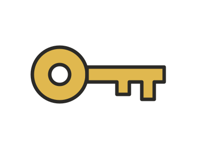
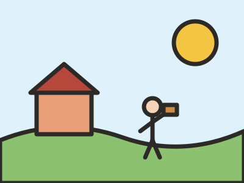
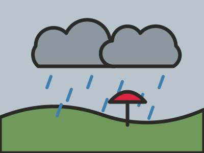
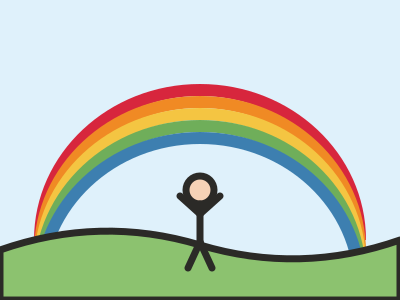

task: lista_palabras
label: Lista de palabras
recording: per_token
randomize: true
repetitions: 2
carrier: Digo {text} otra vez.
instructions: Lee en voz alta la frase que aparece en la pantalla, con naturalidad.
items: words.csv
---
task: lectura
label: Lectura
recording: continuous
instructions: A continuación verás un texto breve. Léelo en voz alta a tu ritmo habitual.
---
<!-- id: parrafo1 -->
El sábado por la tarde, Begoña bajó al mercado del barrio a comprar uvas, dos barras de pan y un trozo de queso de cabra.

Por el camino se encontró con Diego, un amigo de la infancia que había vuelto de Bogotá después de diez años.
---
<!-- id: parrafo2 -->
Se sentaron a tomar un café en la plaza y hablaron de todo un poco: del trabajo, de la familia y de lo mucho que había cambiado la ciudad.

Cuando quiso darse cuenta, ya era de noche y el mercado estaba cerrado.
---
task: denominacion
label: Denominación de imágenes
recording: per_token
randomize: true
instructions: Di en voz alta el nombre de lo que ves en cada imagen.
---

---

---

---

---

---

---
task: narracion
label: Narración con viñetas
recording: both
instructions: Mira las viñetas y cuenta qué pasa, como si se lo contaras a un amigo.
---
<!-- id: vineta1 -->

---
<!-- id: vineta2 -->

---
<!-- id: vineta3 -->

---
<!-- id: resumen -->
  

## ¿Cómo termina la historia?
---
task: entrevista
label: Conversación
recording: continuous
instructions: Ahora vamos a charlar un rato. No hay respuestas correctas ni incorrectas.
---
## ¿Dónde creciste? ¿Cómo era tu barrio?
---
## ¿Qué idiomas se hablaban en tu casa?
---
## Cuéntame algo que te haya pasado y que recuerdes con cariño.
